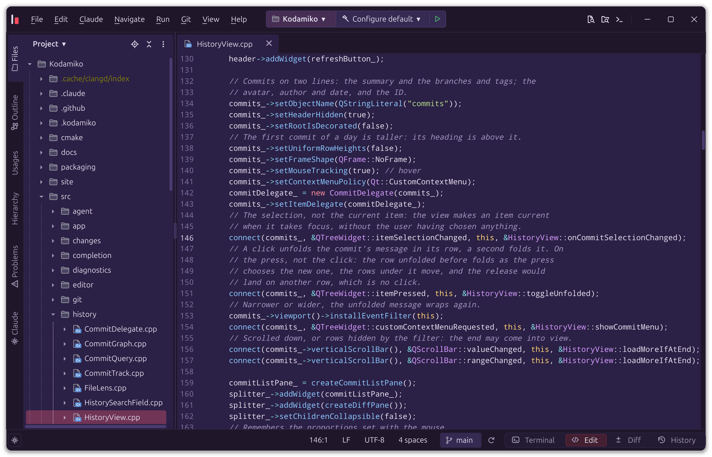

# Kodamiko

Kodamiko is a native desktop editor built around a [Claude Code](https://claude.com/claude-code)
session. You write code on one side; Claude works on the other, in a
terminal inside the editor. Kodamiko keeps the two in step: Claude knows what you
are looking at, and you see, as it happens, every change Claude makes, with
a way to undo it.

It is open source (GPL v3), written in C++23 with Qt 6, and runs on Linux,
Windows and macOS. Kodamiko is in preview: it is used every day to build itself,
and its interfaces may still change.

## Why Kodamiko

The editors we use were designed for a human typing code; AI came later, as
a chat panel on the side or an agent in a terminal that cannot see the
editor. The assistant does not know which file is open or what is selected,
so you keep pointing it at paths and pasting excerpts. It changes files
behind your back, and you discover the result in a diff, if you look. When
it goes wrong, undoing its work is up to you.

Kodamiko starts from the other end, with three ideas:

- **One shared view.** You and Claude look at the same project: the open
  files with their unsaved changes, the selection, the problems, the
  diagrams, the terminals and git. "Fix this" means what is under your
  cursor.
- **Every change visible and reversible.** Files reload as Claude edits
  them, the diff follows each step, and the project can go back to how it
  was before any prompt.
- **You decide.** Claude acts in the editor through tools Kodamiko gives it, and
  whatever changes the repository waits for your *Allow*, asked in plain
  words rather than as a command line.

## What you can do

**Work with Claude.** A Claude Code session starts in your project, in a
built-in terminal. With each prompt, Kodamiko tells Claude which file is open,
where the cursor is, what is selected and which problems are underlined.
Through Kodamiko's own MCP server, Claude reads your open files, finds symbols
and references, opens a file at a line, shows a diff or draws a diagram; the
errors its edits introduce are reported back to it at once. Its permission
requests appear in the editor, never taking the focus from what you type.

**Follow and undo.** Open files reload as Claude edits them, and the Diff
view updates after each step. Claude never overwrites a file you have not
saved. A snapshot of the project is taken before each prompt: *Claude ▸
Restore the State Before a Prompt* brings it back.

**Run agents in parallel.** Start more Claude sessions, each in a git
worktree of its own, so that they never step on each other or on you. Their
work comes back through a merge queue, after the check of your choice
(a build, the tests).

**Review before you commit.** *Claude ▸ Review Staged Changes* has the
changes reviewed, and lays the findings out as cards, file by file, with
the code they are about: dismiss them, or send them back to be fixed.

**Refactor safely.** Rename a symbol or a file, change a function's
signature, move a class to its own file: the language server finds every
usage, a preview shows the result, and *Undo Refactoring* takes it back in
one step, wherever the change went. Claude uses the same refactorings.

**Git without leaving the editor.** Stage by file, hunk or line, commit with
a message Claude writes in the style of your history, browse the history,
switch, merge and rebase branches, resolve conflicts, pull, push and stash.
Git commands Claude would run in a shell go through Kodamiko's tools instead,
so each one is explained, snapshotted and shown.

**A real code editor.** Tree-sitter highlighting for C, C++, Java,
JavaScript, TypeScript and Python; language servers (clangd, jdtls,
typescript-language-server, pyright) for completion, diagnostics, go to
definition, hierarchies and quick fixes; an outline, find in files, a
command palette (Ctrl+Shift+P), run configurations and a rendered Markdown
viewer.

**Diagrams.** Ask for a flowchart, a sequence, a class, a state, a data
model, a C4 architecture or a mind map: Claude writes it in Mermaid or
PlantUML, and it opens laid out in Kodamiko's diagram editor, where you can
rearrange it while Claude keeps editing its source.

## Getting started

Kodamiko **alpha.1.0.2** is a pre-release, the third public build: its
settings and interfaces may still change, and you will meet bugs. Download
it from the [release page](https://github.com/EricPonthiaux/Kodamiko/releases/tag/alpha.1.0.2):

| System | Package |
|---|---|
| Linux x86-64 | `Kodamiko-alpha.1.0.2-linux-x86_64.AppImage`: make it executable (`chmod +x`), then run it |
| Windows x64 | `Kodamiko-alpha.1.0.2-windows-x64.zip`: unzip it anywhere, then run `bin\kodamiko.exe` |
| macOS, Apple silicon | `Kodamiko-alpha.1.0.2-macos-arm64.dmg`: drag Kodamiko to Applications |

Macs with an Intel processor are not supported yet. The packages are not
signed: Windows SmartScreen and macOS Gatekeeper warn before the first
launch (on macOS, open Kodamiko with right click ▸ Open). Their checksums
are in `SHA256SUMS.txt`, on the release page.

At runtime Kodamiko needs [Claude Code](https://claude.com/claude-code) 2.1+
and git 2.23+. If either is missing, *Help ▸ Check Prerequisites* opens on
startup and offers to install it.

To report a bug or suggest an idea, open an
[issue](https://github.com/EricPonthiaux/Kodamiko/issues/new/choose); report
a vulnerability privately, as [`SECURITY.md`](SECURITY.md) says.

## Using Kodamiko

The window has four modes, switched with the tabs at the bottom right:

| Mode | Shortcut | What it shows |
|---|---|---|
| Terminal | Ctrl+1 | The Claude session and your shells |
| Edit | Ctrl+2 | The file tree, the outline and the editor |
| Diff | Ctrl+3 | Pending changes, staging and commit |
| History | Ctrl+4 | The commits of the current branch |

A few shortcuts to start with: F11 jumps to the terminal and back,
Ctrl+Shift+P opens the command palette, Ctrl+Shift+N goes to a file,
Ctrl+Alt+K adds the selected lines to Claude's prompt, and right-clicking
code offers *Explain*, *Review* and *Write Tests*.

Choose colors in *View ▸ Theme* or *Preferences ▸ Appearance*, which shows
a preview of each theme. Four palettes draw on auroras, nebulae and light
to give the editor a more luminous atmosphere:

| Theme | Appearance |
|---|---|
| Kodamiko-Aurora | Deep green, mint light and lavender syntax |
| Kodamiko-Nebula | Dark plum, orchid pink and champagne |
| Kodamiko-Synapse | Midnight blue, ice cyan and periwinkle |
| Kodamiko-Opal | Light pearl, lavender surfaces and amethyst accents |

### Recipes

A *recipe* is how to make one kind of project on one system: a Qt Widgets
application with MSVC on Windows, a Python package… *File ▸ New Project*
lists the recipes of your system; the project gets the recipe's first
files, and from then on:

- its terminals, run configurations and Claude sessions get the recipe's
  environment (Visual Studio's compiler, CMake and Ninja, the Qt kit in
  `CMAKE_PREFIX_PATH`…), without an *x64 Native Tools* prompt;
- Claude gets the recipe's skills and instructions;
- the *Project* menu offers the recipe's prompts, and the *Run* menu its
  Build, Run and Debug configurations.

A recipe belongs to one language (`"language": "cpp"` in its `recipe.json`),
and a project has at most one recipe per language: in *Project Settings*,
select a language, then one of its recipes (its files are not copied). A
project using C++ and Java can combine a Qt recipe and a Maven one; their
environments, tools, configurations, skills and prompts add up. A recipe
is a folder with a `recipe.json`, its `files/`, an
optional `instructions.md` and an optional `skills/` folder (a Claude Code
plugin): see `src/recipes/Recipe.h` and Kodamiko's own in `tools/recipes/`. Yours
go in Kodamiko's application data folder (`recipes/`), or in a project's
`.kodamiko/recipes/` to share them with its repository; one with the same name
replaces Kodamiko's.

*Preferences ▸ Terminal* adds folders of your own in front of the `PATH` of
every program Kodamiko starts.

## How it works

Kodamiko launches `claude` with hooks and an MCP server of its own, without
touching your Claude configuration. Two small programs shipped with the
editor relay them over a local socket: `kodamiko-hook` (prompts, edits,
permissions, status line) and `kodamiko-mcp` (the tools Claude uses to act in
the editor).

The sources are organized by feature under `src/` (`editor`, `git`,
`agent`, `terminal`, `viewers`…); `CLAUDE.md` holds the coding conventions.

## Contributing

Bug reports, ideas and pull requests are welcome: see `CONTRIBUTING.md`.
Report a security problem privately, as `SECURITY.md` explains. The work
planned next is in `docs/roadmap/`.

## License

Kodamiko is distributed under the **GNU GPL v3** (see `LICENSE`), the license
required by QScintilla, with the additional permission below for Graphviz.

**Additional permission under GNU GPL version 3 section 7.** If you modify
this Program, or any covered work, by linking or combining it with Graphviz
(or a modified version of that library), containing parts covered by the
terms of the Eclipse Public License 1.0, the licensors of this Program grant
you additional permission to convey the resulting work. Corresponding Source
for a non-source form of such a combination shall include the source code
for the parts of Graphviz used as well as that of the covered work.

The permission is needed because the EPL 1.0 is not compatible with the GPL,
and the diagram editor links Graphviz's library. It covers Kodamiko's own code
only; the other components keep their licenses.

**Trademarks.** The GPL covers the code, not the name or the logo: as
section 7(e) of the GPL v3 allows, *Kodamiko* and its K mark are not
licensed with it. What you may do with them, and what needs permission, is
in `TRADEMARKS.md`; a modified version takes another name.

Third-party components:

| Component | Distributed | License |
|---|---|---|
| Qt 6 | linked dynamically | LGPL v3 |
| QScintilla | built and linked statically | GPL v3 |
| tree-sitter and grammars | built and linked statically | MIT |
| libvterm | built and linked statically | MIT |
| libgit2 | built and linked statically | GPL v2 with linking exception |
| cmark-gfm | built and linked statically | BSD 2-Clause |
| Graphviz (optional, diagram editor) | linked from the system; on Windows, its release's DLLs ship with Kodamiko | Eclipse Public License 1.0 |
| github-markdown-css, Octicons (in `third_party/`) | embedded | MIT |
| SchemaStore's Claude Code settings schema (in `third_party/schemastore/`) | embedded | Apache 2.0 |
| Ubuntu Sans, Ubuntu Sans Mono (in `third_party/fonts/`) | embedded | Ubuntu Font Licence 1.0 |
| Droid Sans Mono (in `third_party/fonts/`) | embedded | Apache 2.0 |
| JetBrains Mono (in `third_party/fonts/`) | embedded | SIL Open Font License 1.1 |
| Dracula, Nord, Night Owl, Palenight, Tokyo Night (VS Code themes) | their colors, moved to Material's palette, in `src/ui/MaterialThemes.cpp` | MIT |

The versions of the downloaded components are pinned in
`cmake/Dependencies.cmake`; those of the embedded files in
`third_party/README.md`.
